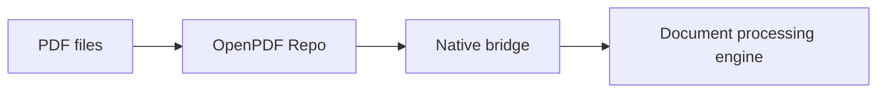

# OpenPDF


CLI/SDK for PDF generation, merge, split, and metadata extraction. The processing engine handles all formats internally, exposing a native bridge to Node.js consumers and end users.

Key differentiators: multi-PDF concatenation and page-range splitting, plus programmatic PDF creation from scratch — none of these require an external PDF library or Adobe Acrobat.

## 🧩 Architecture



## What's NOT here

- **No PDF implementation** — PDF grammar, page tree, content stream encoding, font embedding, and incremental updates all belong in the shared engine.
- **No text extraction or OCR** — glyph-level text extraction from content streams lives in the engine; OCR is out of scope for this product.
- **No merge/split algorithms** — page tree rewiring, content stream concatenation, and resource deduplication are core engine logic.
- **No fixture corpus** — golden PDFs, conformance fixtures, and round-trip acceptance scripts live downstream.

## 🚀 Usage (placeholder)

```bash
# Extract metadata — title, author, bookmarks, page count
open-pdf inspect input.pdf

# Merge multiple PDFs into one
open-pdf merge a.pdf b.pdf c.pdf -o combined.pdf

# Split by page range
open-pdf split input.pdf --ranges 1-5,10,15-20 -o output/

# Create a PDF programmatically
open-pdf create --out empty.pdf --title "Empty Deck" --pages 1
```

```ts
import { OpenPDF } from '@wae/open-pdf';

const doc = await OpenPDF.read('input.pdf');
console.log(doc.metadata.title, doc.pageCount);

// Extract a page range into a new document
const sliced = doc.slice({ from: 10, to: 20 });
await sliced.write('pages-10-20.pdf');

// Concatenate multiple PDFs
const combined = await OpenPDF.concat([
  await OpenPDF.read('a.pdf'),
  await OpenPDF.read('b.pdf'),
]);
await combined.write('combined.pdf');
```

## 🧱 Repo layout

```
OpenPDF/
├── package.json
└── Readme.md
```

This is a scaffold repo. The native bridge wiring, CLI binary, and CLI entry points are added incrementally as the shared processing engine lands.
