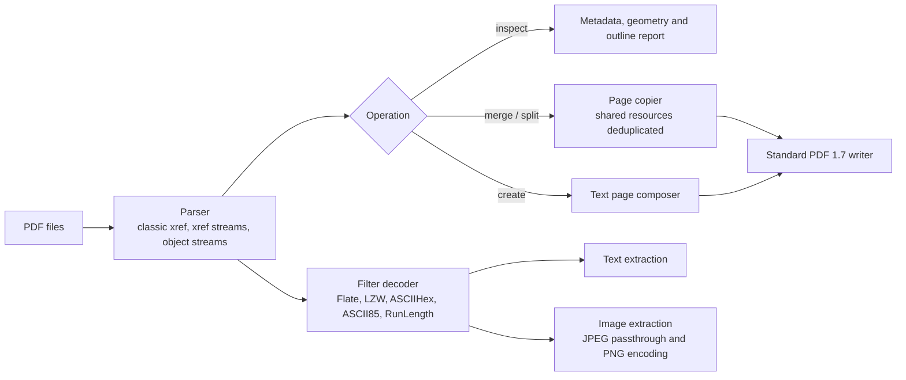

# OpenPDF


Generate, merge, split and inspect PDF files from one command line or one small
SDK. The built-in engine parses the page tree, metadata, outlines, classic and
stream-based cross-reference tables, object streams and Flate-compressed streams
itself, and writes standard PDF 1.7 files — no external PDF library, no Adobe
Acrobat, no system dependency.

## ✨ What you can do

- Create a PDF from text with selectable paper size (`a3`/`a4`/`a5`/`letter`/
  `legal`/`tabloid` or `WIDTHxHEIGHT`), base-14 font, font size, margins,
  left/center/right alignment, automatic wrapping and automatic pagination.
- Write title, author, subject, keywords and creator metadata, and draw a
  `page / total` footer.
- Merge any number of PDFs and keep their page order.
- Split by 1-based ranges such as `1-5,10,15-20`, or into fixed-size chunks.
- Reorder, remove and rotate pages without re-rendering them.
- Rewrite the document information dictionary.
- Paint a text stamp — watermark, header or footer — on every page or a page
  range, with font, size, rotation, opacity and colour control. `{page}` and
  `{pages}` placeholders are substituted per page.
- Read version, page count, page geometry, document metadata, bookmarks and
  AcroForm fields from classic PDFs as well as PDFs that use cross-reference and
  object streams.
- Extract text from Flate, LZW, ASCIIHex, ASCII85 and RunLength streams and
  report every skipped part.
- Extract embedded images: JPEG payloads are written unchanged and 8-bit
  DeviceGray/DeviceRGB streams become PNG (with `/SMask` alpha).

## 🚀 Usage

```bash
# Read version, pages, metadata, page sizes and outlines
open-pdf inspect input.pdf

# Merge files in argument order
open-pdf merge cover.pdf chapter-1.pdf chapter-2.pdf -o combined.pdf

# Split into page-range files: input-p1-5.pdf, input-p10.pdf, ...
open-pdf split input.pdf --ranges 1-5,10 --out-dir pages/

# Split into consecutive files of at most 2 pages: input-p1-2.pdf, input-p3-4.pdf, ...
open-pdf split input.pdf --every 2 --out-dir chunks/

# Create two styled pages; | separates lines inside one page
open-pdf create --out notes.pdf --title "Meeting notes" \
  --page "Agenda|1. Budget|2. Timeline" \
  --page "Decisions" \
  --page-size a4 --font times --font-size 14 --margin 56 \
  --align center --author "Ada" --page-numbers

# Reorder, drop and rotate pages
open-pdf arrange input.pdf -o arranged.pdf --order 3,1,2 --remove 4 --rotate 90

# Rewrite metadata
open-pdf set-metadata input.pdf -o tagged.pdf --title "Final" --author "Ada"

# Watermark every page, or only pages 1-3
open-pdf stamp input.pdf -o draft.pdf --text "DRAFT {page}/{pages}" \
  --position center --rotation 45 --opacity 0.25 --color "#CC0000"
open-pdf stamp input.pdf -o footer.pdf --text "Internal" --position bottom --pages 1-3

# Extract text and list extraction losses
open-pdf extract-text notes.pdf

# Extract embedded images as JPG/PNG into a directory
open-pdf extract-images notes.pdf -o images/
```

The same operations are available through the session SDK. The session is the
product; the CLI is a thin consumer of it:

```ts
import { OpenPDF } from '@wae/open-pdf';

const pdf = new OpenPDF({ locale: 'zh-CN', overwrite: true });

const info = await pdf.inspect('input.pdf');
console.log(info.version, info.pages, info.metadata.title);

await pdf.merge(['a.pdf', 'b.pdf'], 'combined.pdf', { title: 'Combined' });
await pdf.split('combined.pdf', '1-2,3', 'pages');
await pdf.splitEvery('combined.pdf', 2, 'chunks');
await pdf.create({ out: 'hello.pdf', title: 'Hello', pages: ['line one\nline two'] });
await pdf.create({
  out: 'styled.pdf',
  title: 'Styled',
  pages: ['Centered body text'],
  pageSize: 'a4',
  font: 'times',
  fontSize: 16,
  marginPt: 56,
  align: 'center',
  pageNumbers: true,
});

const stamped = await pdf.stamp('styled.pdf', 'draft.pdf', {
  text: 'DRAFT {page}/{pages}',
  position: 'center',
  rotation: 45,
  opacity: 0.25,
  color: '#CC0000',
});
console.log(stamped.pagesStamped);

const text = await pdf.extractText('hello.pdf');
console.log(text.markdown, text.losses);

const images = await pdf.extractImages('hello.pdf', 'images');
console.log(images);
```

`OpenPDF.capabilities(...)` and the other synchronous static methods stay as
compatibility wrappers for callers that do not keep a session.

`open-pdf capabilities` prints the honest support matrix, including what is
partial and what is not supported at all.

## 🧩 How it works



## 🧱 What it does NOT do

- **No encrypted PDFs** — files with `/Encrypt`, in a classic trailer or an
  xref stream, are rejected and never decrypted.
- **No image codecs** — `/DCTDecode` is copied as a JPEG only when its payload
  already starts with the SOI marker; `/JBIG2Decode`, `/CCITTFaxDecode` and
  `/JPXDecode` are reported as losses. PNG output covers 8-bit DeviceGray and
  DeviceRGB only.
- **No rendering or rasterization** — no page preview, SVG or print output; PNG
  files are re-encoded embedded images, not rendered pages.
- **No repair of incremental updates beyond a linear scan** — malformed or
  truncated input returns a stable error code instead of a best-effort document.
- **No form filling, JavaScript or digital signatures** — AcroForm fields are
  read for inspection only.
- **No font embedding** — created documents select among the base-14 fonts
  (Helvetica, Times, Courier and their bold variants) with WinAnsi-compatible
  text; custom TrueType embedding is not implemented.
